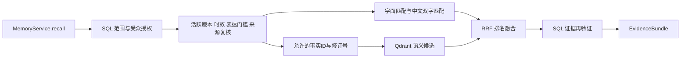

# 事实索引与检索融合接入

日期：2026-10-21。分支 local/memory-runtime-20261021。未部署生产。

## 读取路径

索引没有授予权限的能力。先由 SQL 查出可见的当前事实，再验证来源；向量搜索只能命中允许的版本点 ID，并在融合后再验证 bundle。min_favor 高于服务端 expression_ceiling 的事实不会进入向量候选，访问范围门控、人设写入门控保留原有规则。

中文采用查询双字片段覆盖率至少 0.5 的匹配；字面匹配、双字匹配和可选语义候选使用 RRF 融合。双字匹配会存在误召回，不是分词全文索引。SQL 候选和来源目前逐条扫描，尚未达到大规模检索性能目标；语义检索最多使用最近1000个已授权当前版本。无查询时保留原有最近事实行为。

索引不可用、配置错误或语义检索超过3秒时，降级为本地字面／双字匹配。新事实不等索引追平即可被本地通路检索到。

## 写入与重试

事实事务继续同时写 index outbox。新增迁移18由 poe db-revision fact_index_leases 自动生成，补充 lease_token 和 lease_until。消费者使用行锁与 skip_locked 领取60秒租约；每次按 SQL 当前事实状态投影，不把事件先后顺序当作版本顺序。

外部索引操作最多45秒。成功或失败确认均校验当前租约 token 和有效期；失败指数退避2到32秒，最多5次进入 dead_letter，过期的耗尽任务不会堵住后续工作。普通日志只记录事件ID与异常类型。模型和向量服务现有依赖日志仍遵循原实现。

活跃且来源有效的事实写向量，其它事实删除当前 collection 中该 assertion 的向量。点ID为事实ID和 row_revision 的确定性UUID；payload只存 assertion_id 和 revision，不复制正文。旧版本即便仍留在索引中也不在允许ID列表里。

collection 使用独立前缀 nekro_facts_v1_，并包含模型组、模型名、端点和维度等配置的哈希。索引不改旧段落 collection。已有 collection 的维度或距离配置冲突时拒绝继续，不自动删除重建；embedding 期间配置变化时拒绝向旧 collection 写入。

## 开关、重建和边界

- MEMORY_FACT_INDEX_ENABLED 默认 false，同时控制后台索引消费和召回语义通路。总记忆开关关闭时后台消费停止。
- 该开关可以独立于事实抽取开关运行；启动时两者均关闭则不会创建后台任务，之后启用需要显式 start 或受控重启。当前调度每轮消费1条索引任务，默认间隔10秒；不是高吞吐实现。
- 显式 FactIndexWorker(index).rebuild() 会为所有已有 assertion 补建 reconcile 待办，写向量本身幂等；包括非活跃记录以便清除旧投影。当前ORM迭代会加载完整结果，大库分页调度、UI、运维进度和死信重放入口仍待补全。
- 切换模型／维度会换 collection，历史 done 事件不会自动重放；需在受控环境调用 rebuild 并等待追平。旧 collection 的物理删除需要另行运维管理。
- PostgreSQL 和 Qdrant 没有跨库事务。租约过期的在途请求可能迟到写入旧版本点；SQL复核确保其不能恢复可读内容，但物理向量清理仍需对账／重建。来源编辑或撤回未必产生索引事件，同样不能把逻辑不可读解释为向量已经物理清除。
- 本轮同时补充 bundle 有效时间窗口的复核，但真正的HTTP模型发送前复核链路仍待贯穿；关系表达依赖、历史迁移、专用全文索引及大规模检索优化未完成。

## 验证

20项新测试覆盖真实隔离PostgreSQL的领取、租约接管、过期确认、重试／死信、乱序更正、遗忘、来源撤回、授权与表达门槛、中文本地降级、恶意候选、配置中途变更和重建入口。另包含真实临时Qdrant的筛选、删除、元数据payload及维度冲突保留测试；embedding使用离线替身，没有调用真实模型。

全部相关测试177项通过，poe lint通过，poe db-revision verify_index_schema返回No changes detected。未迁移生产数据库、改线上配置或重启Agent。
