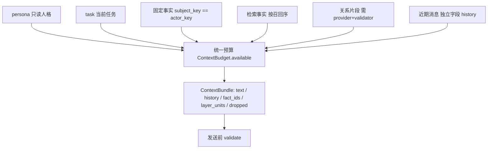

# Agent 上下文编排接口

MemoryContextBuilder 位于 Agent 编排层，不接管事实或好感度的存储。每次 build 只执行一次事实 recall，拼接只读人格、当前任务、固定事实、检索事实、经权限校验的关系片段，并把单份近期窗口作为独立字段交回调用方。

预算显式扣除输出、工具、安全和模板开销；长期事实另有上限 `memory_limit`。条目超限整条舍弃，不截断半条事实或人格规则；人格超限直接抛 `CONTEXT_REQUIRED_BLOCK_TOO_LARGE`。计量单位由 `PromptUnits` 决定：优先 tiktoken，缺词表时回落 UTF-8 字节上界，方法名写入 `budget_method`。此处只计量装配出的文本，其他模板与消息封装开销必须由调用方通过 `prompt_overhead_units` 传入。

近期窗口不再并入 `bundle.text`：编排器只判断「这条消息还装得下吗」，被接纳的行走 `bundle.history`，由 `render_history_data` 渲染。这样记忆块与近期消息在同一预算下竞争，而不是各自独立截断。

关系提供器与验证器必须同时存在才能使用关系片段；缺少验证器、来源不明、超时或提供器失败均使用中性结果。发送前关系验证失效时拒绝继续使用旧 bundle，不因亲密度扩大事实权限。两者可由插件通过 `register_relationship_source` 注册到模块级注册表，`MemoryContextBuilder` 未显式传参时自动取用，保证装配与复核同源。

本批已替换 history.py 的 service 分支装配（legacy 分支保持不变），由 `render_history_data` 调用。未宣称当前线上已经消除重复召回或完成全模型预算统一。