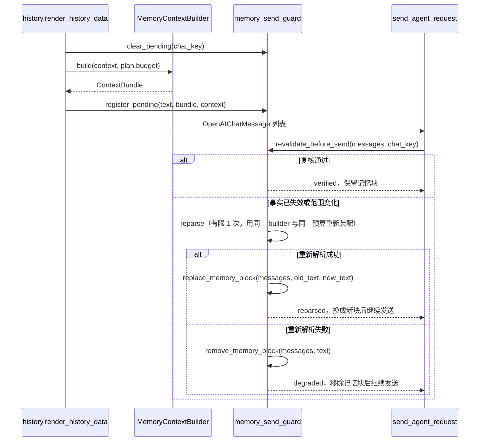

# 发送前证据复核与统一窗口预算

日期：2026-10-21。分支 local/memory-runtime-20261021。未部署生产，默认配置下行为与之前一致（计量器不可用时回落到 3 字节/token 上界）。

## 组装与发送之间



`send_agent_request` 是所有模型请求的唯一收敛点：首发与工具迭代后的第二次请求都经过它（nekro_agent/services/agent/run_agent.py:468 起的重试循环之前）。因此复核放在这里，而不是放在两个调用点分别做。

复核失败不抛错、不失败本轮对话，按设计文档 §11.1 的「有限重新解析，失败降级」处理：

1. 先按登记的重建回调 `rebuild`（同一个 builder、同一个 `ContextBudget`、同一个计量器）重新装配一次，最多 `MAX_REPARSE_ATTEMPTS = 1` 次；
2. 成功则用 `replace_memory_block` 原地把旧块文本换成新块文本，返回 `reparsed`，轨迹事件带 `previous_fact_count`；
3. 重建回调缺失、抛错，或旧块在 messages 里找不到对应文本时，退化为 `remove_memory_block` 剥离记忆块并返回 `degraded`。

登记表以 chat_key 为键，每次装配先 `clear_pending`、发送时 `take_pending` 取走，避免上一轮证据被误用或重复消费。复核结果写入轨迹事件 `memory_context_revalidated`（status=verified/reparsed/degraded/skipped，附带 fact_count、previous_fact_count 与 error_summary）。

## 预算口径

新增 nekro_agent/services/agent/prompt_budget.py，用 `PromptUnits(name, per_token, counter)` 表示计量单位，装配与发送前复核共用同一份计数器。

- 计量器优先使用 tiktoken（`cl100k_base`），方法名记为 `tiktoken:cl100k_base`；词表缺失或离线时回落到 UTF-8 字节上界（3 字节/token），方法名记为 `utf8_bytes_upper_bound:*`。方法名写入 `ContextBundle.budget_method` 与调试日志，便于事后核对实际用的哪种口径。
- 未声明 `AI_CONTEXT_WINDOW_TOKENS`（默认 0）：沿用旧语义，只约束记忆块，`memory_limit = MEMORY_CONTEXT_MAX_LENGTH`，budget_method 后缀为 `legacy_char_config`。
- 声明了窗口：先由系统提示词等已确定内容作为 `prompt_overhead`，再从窗口扣除预留输出、工具实际占用与安全余量，剩余部分才给记忆块；记忆块上限取配置值与剩余窗口的较小者。
- 工具结果实际用量与配置预留取较大者（`tool_reserve = max(AI_CONTEXT_TOOL_RESERVE_TOKENS, 实际占用)`），迭代轮次里本轮工具结果尚未进入 messages 时按待发送文本先占位，避免记忆块把它挤爆。
- 剩余预算不足或出现负数/布尔/非整数输入时抛 `CONTEXT_BUDGET_INVALID`，由 history 的既有异常兜底降级为不注入记忆块。

新增配置（nekro_agent/core/config.py，聊天配置分类，均可覆盖）：

| 配置 | 默认 | 含义 |
| --- | --- | --- |
| AI_CONTEXT_WINDOW_TOKENS | 0 | 模型窗口；0 表示未声明 |
| AI_CONTEXT_RESERVED_OUTPUT_TOKENS | 1024 | 为回复预留 |
| AI_CONTEXT_TOOL_RESERVE_TOKENS | 0 | 为工具结果预留 |
| AI_CONTEXT_SAFETY_MARGIN_TOKENS | 256 | 估算误差余量 |

## 优先级与近期窗口

`MemoryContextBuilder.build` 按设计文档 §10.5 的顺序装配：

1. 只读人格与权限约束（`persona`）：超限直接抛 `CONTEXT_REQUIRED_BLOCK_TOO_LARGE`，不静默截断；
2. 当前任务与用户明确约束（`task`）；
3. 固定事实：`subject_key == context.actor_key` 的事实排在检索事实之前，两层内部保持召回序；每条事实完整体检或整条丢弃（`dropped` 记 `fact:<id>`）；
4. 简洁关系表达：仅在 provider 与 validator 同时可用且校验通过时进入记忆块，否则记 `relationship:unverified` / `relationship:unavailable`；
5. 单份近期消息：不再并入记忆块正文，而是单独做预算接纳放在 `ContextBundle.history`，由调用方按接纳结果渲染。

每一层的实际占用量记在 `ContextBundle.layer_units`（键 `persona`/`task`/`facts`/`history`/`relationship`），便于核对额度分配。`used_units` 同时包含记忆块与已接纳的近期窗口，不再只统计记忆块。

`render_history_data` 先渲染好近期消息行，按由新到旧交给编排器做预算接纳，只渲染被接纳的行；`AI_CONTEXT_LENGTH_PER_SESSION` 退为次级字符上限，用于防止超长单条消息一次占满窗口。

## 关系片段来源

核心不 import 插件。关系提供器与校验器由插件在初始化阶段注册到核心侧的模块级注册表：

```python
from nekro_agent.services.agent.memory_context import register_relationship_source

register_relationship_source(provider=..., validator=..., label="nekro_memory_angel")
```

`MemoryContextBuilder` 未显式传参时自动取注册表，因此**装配与发送前复核使用同一对回调**，撤权复核不再空转。`clear_relationship_source(label=...)` 在插件卸载时调用。构造时显式传入的 provider/validator 优先于注册表，测试与离线场景可覆盖。

## 仍未完成

- 插件侧关系数据的可导出 revision（第六阶段前置）：当前 SQLite 关系状态没有 revision 计数列，validator 只能做存在性与归属校验，无法比对版本号。
- 供应商返回的真实用量没有回填到预算做闭环校对；tiktoken 计数与供应商计量在中文场景下仍可能有偏差。
- 插件短期窗口与核心近期窗口尚未真正收敛为同一份，目前仅由核心统一预算接纳。
