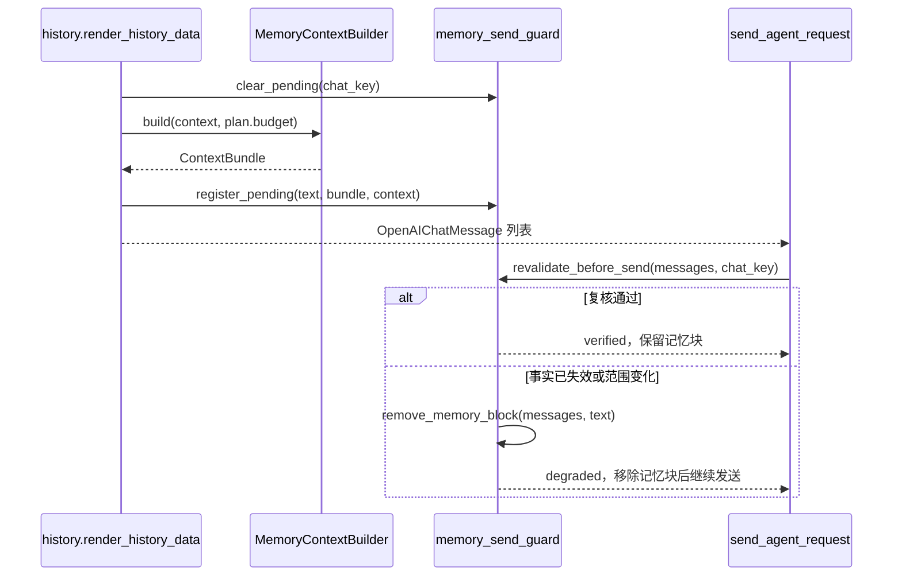

# 发送前证据复核与统一窗口预算

日期：2026-10-21。分支 local/memory-runtime-20261021。未部署生产，默认配置下行为与之前一致。

## 组装与发送之间

`send_agent_request` 是所有模型请求的唯一收敛点：首发与工具迭代后的第二次请求都经过它（nekro_agent/services/agent/run_agent.py:468 起的重试循环之前）。因此复核放在这里，而不是放在两个调用点分别做。

复核失败不抛错、不重试、不失败本轮对话：只按登记的记忆块原文从消息文本片段中剥离，然后照常发送。登记表以 chat_key 为键，每次装配先 `clear_pending`、发送时 `take_pending` 取走，避免上一轮证据被误用或重复消费。复核结果写入轨迹事件 `memory_context_revalidated`（status=verified/degraded/skipped，附带 fact_count 与 error_summary）。

## 预算口径

新增 nekro_agent/services/agent/prompt_budget.py，计量单位与 `MemoryContextBuilder` 一致，都是 UTF-8 字节上界。

- 未声明 `AI_CONTEXT_WINDOW_TOKENS`（默认 0）：沿用旧语义，只约束记忆块，`memory_limit = MEMORY_CONTEXT_MAX_LENGTH`，budget_method 记为 `utf8_bytes_upper_bound:legacy_char_config`。
- 声明了窗口：先由系统提示词等已确定内容的字节数作为 `prompt_overhead`，再从窗口扣除预留输出、工具结果余量与安全余量；token 按 3 字节保守折算，budget_method 记为 `utf8_bytes_upper_bound:window_tokens_x3`。记忆块上限取配置值与剩余窗口的较小者。
- 剩余预算不足或出现负数/布尔/非整数输入时抛 `CONTEXT_BUDGET_INVALID`，由 history 的既有异常兜底降级为不注入记忆块。

新增配置（nekro_agent/core/config.py，聊天配置分类，均可覆盖）：

| 配置 | 默认 | 含义 |
| --- | --- | --- |
| AI_CONTEXT_WINDOW_TOKENS | 0 | 模型窗口；0 表示未声明 |
| AI_CONTEXT_RESERVED_OUTPUT_TOKENS | 1024 | 为回复预留 |
| AI_CONTEXT_TOOL_RESERVE_TOKENS | 0 | 为工具结果预留 |
| AI_CONTEXT_SAFETY_MARGIN_TOKENS | 256 | 估算误差余量 |

预算按 UTF-8 字节估算，不是真实 tokenizer 计量；3 字节/token 是保守上界，实际用量应由供应商返回的计量校验。历史窗口的 `AI_CONTEXT_LENGTH_PER_SESSION` 字符截断仍然独立生效，本次没有改动它的语义。

## 仍未完成

- 记忆块以外的各段（工具结果、插件提示词、迭代追加消息）没有统一编排，目前只把它们作为已确定开销扣除。
- 关系片段（RelationshipFragment）在预算内与事实块共享同一上限，但没有按优先级单独分配额度。
- 未接入真实 tokenizer，也未用供应商计量做闭环校对。
